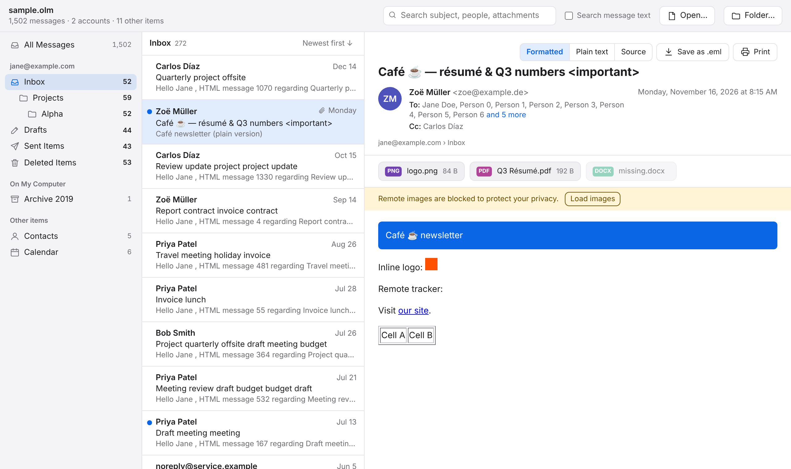

# OLM Viewer

**Outlook, .eml & .mbox mail viewer.** OLM Viewer opens Outlook for Mac archives (`.olm`), email files (`.eml`, `.emlx`) and mailboxes (`.mbox`) privately in your browser. It needs no install, no account and no internet connection, and your mail is never uploaded.

**[Open OLM Viewer →](https://sfschouten.github.io/olm-viewer/)**

## Using it

Use either of these:

- **Online:** open [sfschouten.github.io/olm-viewer](https://sfschouten.github.io/olm-viewer/), then choose or drag in your files. The page reads them inside your browser and never sends them anywhere.
- **Offline:** download [`olm-viewer.html`](olm-viewer.html) and double-click it. It's a single file that runs in Safari, Chrome, Firefox or Edge on macOS, Windows or Linux.

You can open single files, several at once, or a whole folder with **Choose folder…** or by dragging it onto the window.

## What it opens

| Format | Where it comes from |
| --- | --- |
| `.olm` | Outlook for Mac: **File › Export…** |
| `.mbox` | Apple Mail: **Mailbox › Export Mailbox…** (open the `.mbox` folder it creates) |
| `.mbox` | Gmail: [Google Takeout](https://takeout.google.com/) (Gmail labels show up as folders) |
| Thunderbird mailboxes | Your Thunderbird profile's `Mail` or `ImapMail` folder. Open the folder, and subfolders appear in place. |
| `.eml` | Most mail apps: drag a message to the desktop or use "Save as" |
| `.emlx` | Apple Mail's own storage in `~/Library/Mail` |

From `.olm` archives it also shows **contacts, calendar events, tasks and notes**.

## Features

- Folder tree, unread markers, sorting, and keyboard navigation (↑/↓, `/` to search)
- Instant search over subjects, people, previews and attachment names, plus an optional full-text search of message bodies
- Formatted, plain-text and source views of each message
- Inline images, attachments you can save, and forwarded messages that open in place
- **Save as .eml**, which opens in Apple Mail, Outlook and Thunderbird, and **Print**
- Light and dark mode
- Handles large archives: a 100,000-message, 450 MB mailbox lists its first messages in about 2 seconds

## Privacy and safety

- **Nothing leaves your computer.** The page has no server side and no analytics. Your files are read directly from disk by your browser.
- **Remote images are blocked** until you click **Load images**, so senders can't track when you opened a message.
- **Email content is sandboxed.** Scripts in emails never run, links open in a new tab, and the real sender address is always shown, even when a display name tries to look like a different address.

## Limitations

- `.pst` and `.msg` files (Outlook for Windows) aren't supported.
- An `.olm` stores times without a time zone. They are shown as UTC converted to your local time.
- Encrypted (S/MIME or PGP) messages are listed, but their contents can't be decrypted.

## How it works

Everything is in one HTML file with no dependencies:

- **`.olm` archives** are ZIP files. A small random-access ZIP reader (with zip64 support) unpacks only what is needed, so multi-gigabyte archives open quickly.
- **Mailboxes** are scanned for message boundaries, and only each message's headers are read up front.
- **Message parsing** uses a MIME parser written for this project. It covers RFC 2045–2047, 2231, 3676 and 6532, and copes with the mixed and mislabelled character sets common in real mail.
